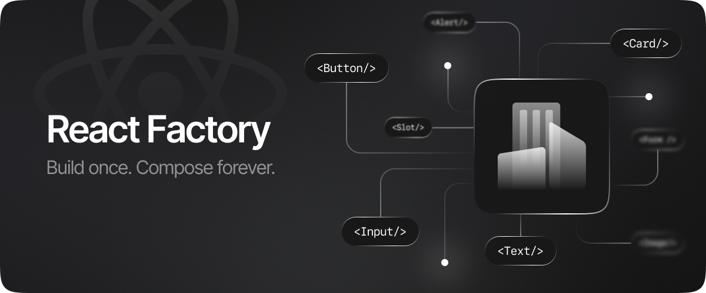

# Introduction

A set of lightweight, specialized utilities that standardize recurring front-end development patterns. Each package targets one such pattern and turns it into a single, typed, reusable primitive: less duplicated logic, more consistent behavior across a codebase.

## Motivation

The same piece of front-end logic shows up in project after project, solved a little differently each time. One team wraps it in a hook, another copies a snippet from an older repo, and the two versions drift further apart with every change. This suite exists to give that recurring logic one home instead of scattered, slightly different versions. Each package picks a single, well-defined problem and turns it into a typed, reusable primitive, so a team reaches for the same tool every time instead of writing another version of it.

The scope stays narrow on purpose. The main goal is to create tools that help address common patterns and use cases and solve them in a targeted manner without introducing unnecessary complexity and without being tied to global architectural solutions.

## Packages

| Package | Version | Description |
| --- | --- | --- |
| 📦 [`@react-factory/create-component`](./packages/create-component) |  | A lightweight factory for building type-safe, polymorphic React components. |
| 📦 [`@react-factory/create-context`](./packages/create-context) |  | A tiny factory for creating a React context and providing convenient access to it. |
